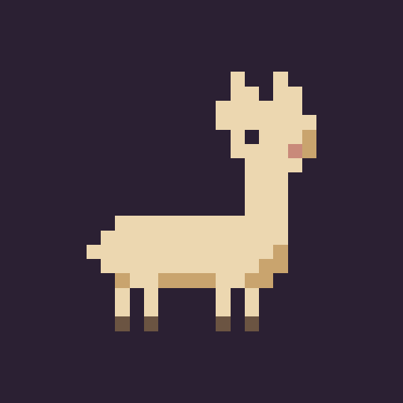

  

<h3 align="center">Alpaca Labs</h3>

Small apps, built with a lot of care. · Kleine Apps, mit viel Liebe gebaut.

<a href="mailto:support@alpacalabs.de">support@alpacalabs.de</a> · <a href="https://ko-fi.com/alpacalabs">♥ Ko-fi</a>

---

### 🏠 For Home Assistant

**[HausPanel](https://github.com/alpacalabs-de/hauspanel)** – a Home Assistant dashboard that lays itself out from your rooms, for the wall tablet, your phone and a camera screen. Free and open source, install it through HACS.

Like what we make? You can [buy us a coffee on Ko-fi](https://ko-fi.com/alpacalabs). · Gefällt dir, was wir machen? [Spendier uns einen Kaffee](https://ko-fi.com/alpacalabs).
